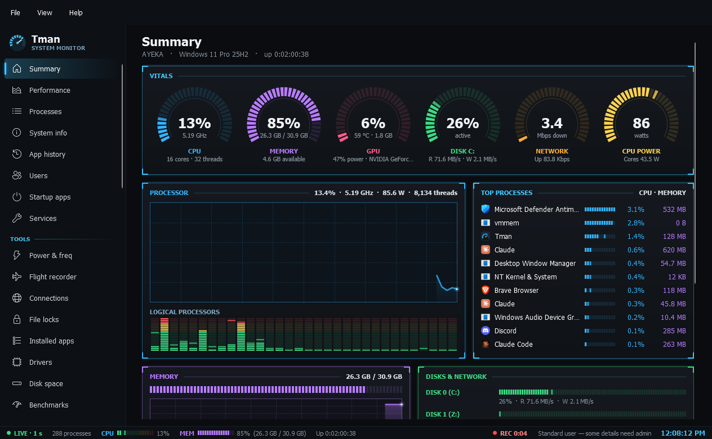
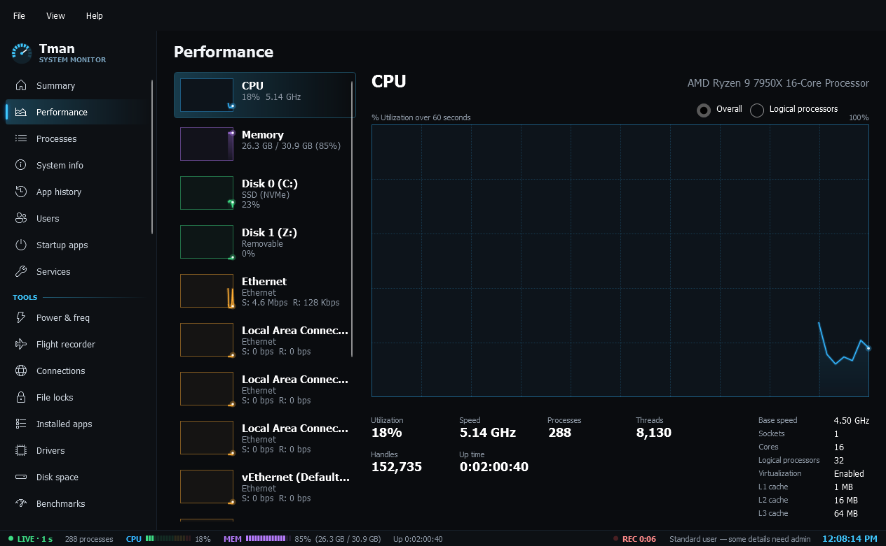
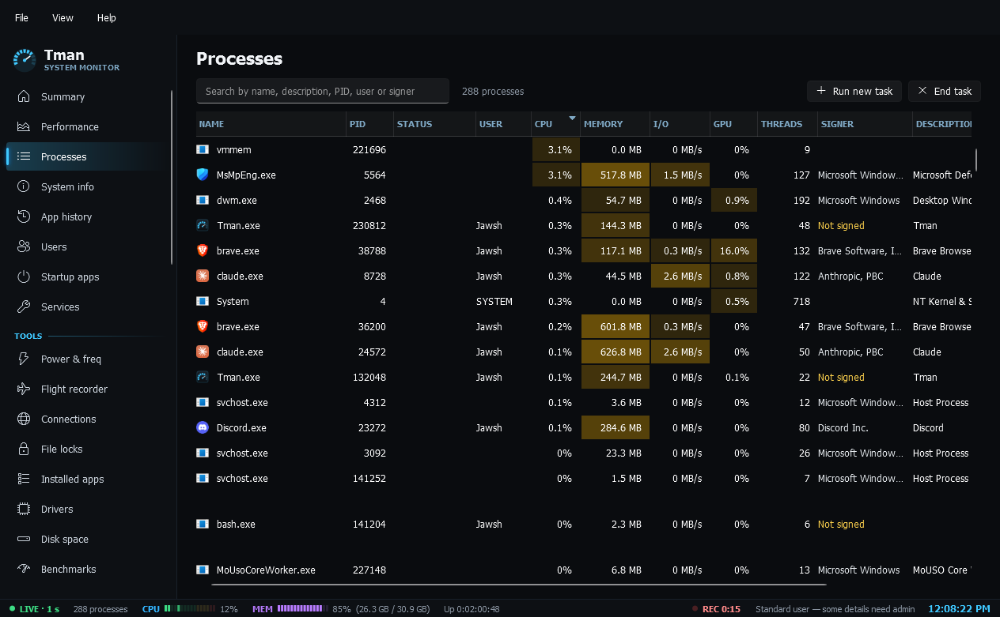
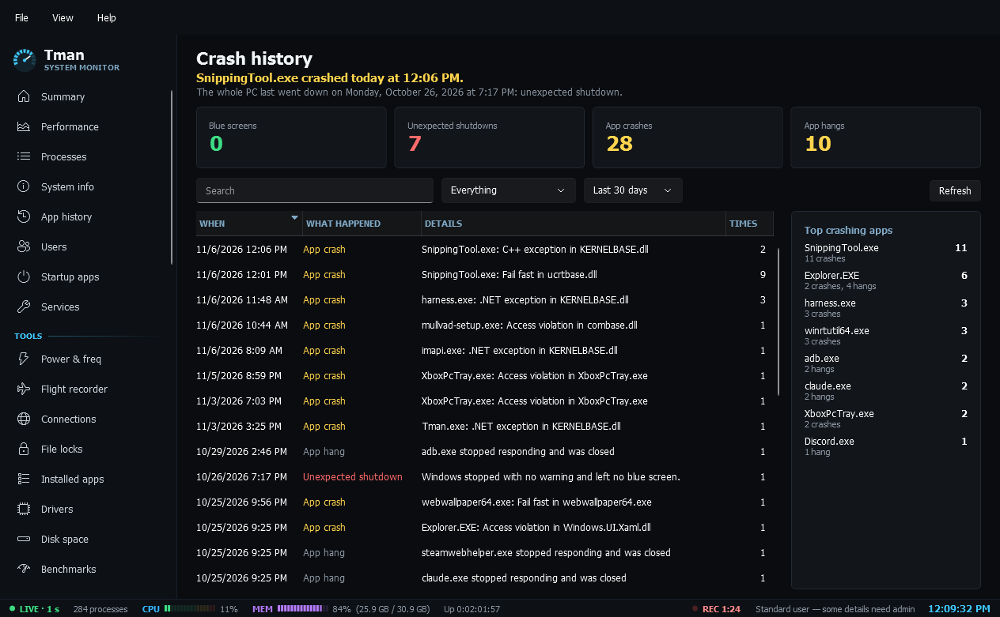
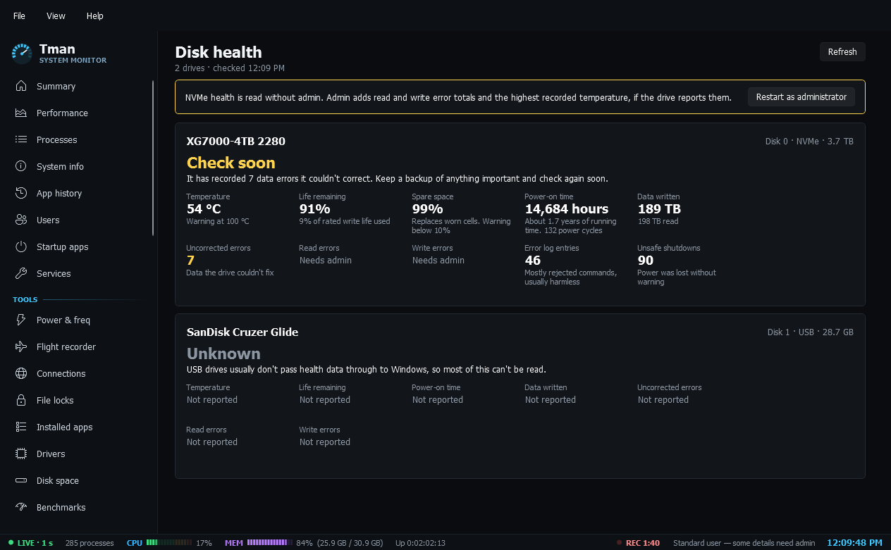
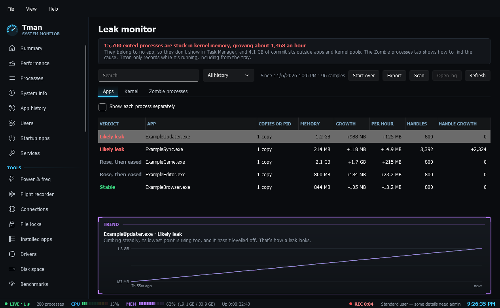
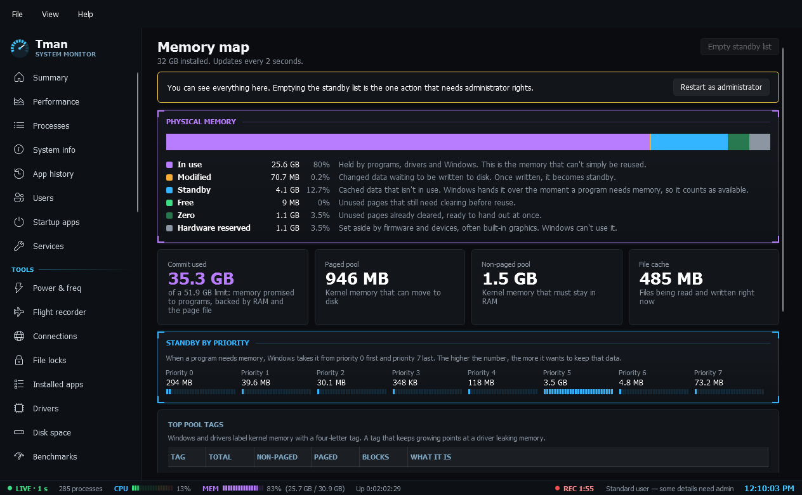
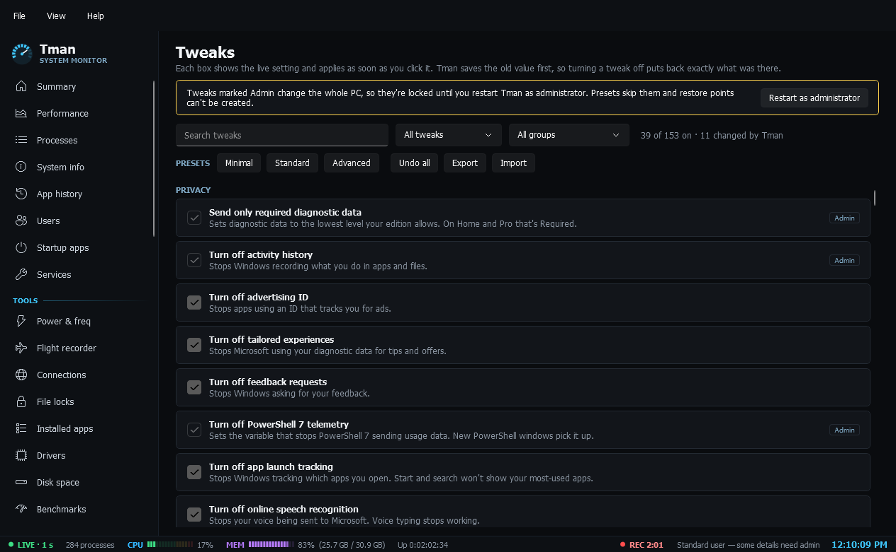
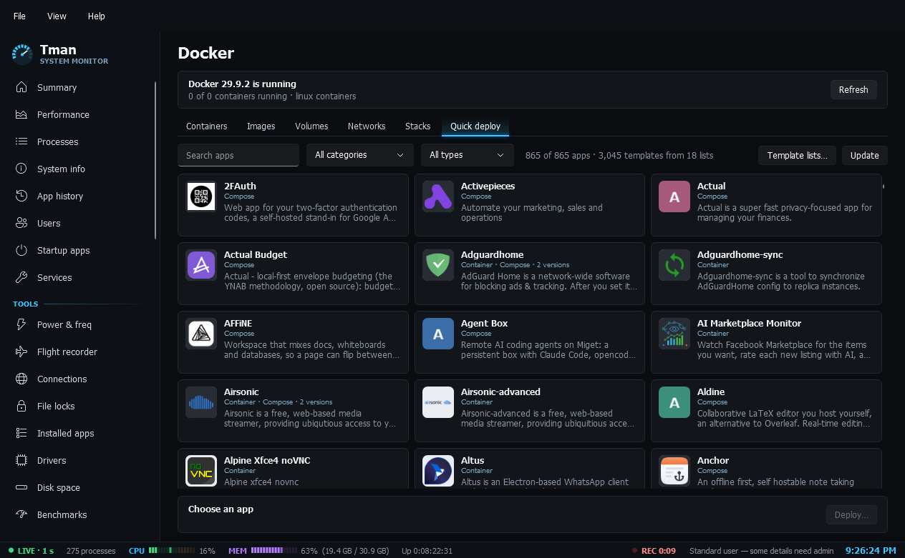

<div align="center">


# Tman

**A task manager that grew into a Windows toolbox.**<br>
Monitor, diagnose, tweak and repair Windows 11, run Docker and Hyper-V, all in one window.

[](#download)
[](https://dotnet.microsoft.com/download/dotnet/10.0)
[](#under-the-hood)
[](#download)
[](https://github.com/JawshTheDark/Tman/releases)
[](https://github.com/JawshTheDark/Tman/actions/workflows/build.yml)

[Features](#features) •
[Download](#download) •
[Screenshots](#screenshots) •
[Wiki](docs/wiki/Home.md) •
[Status](#status) •
[Building](#building)



</div>

## Why Tman

Windows keeps its tools in a dozen places: Task Manager, Resource Monitor, Device Manager, Services, Event Viewer, Disk Cleanup, winget, the Settings app and a dozen Control Panel applets that are harder to find every year. Tman puts the jobs those tools do into one window:

- **It explains itself.** Crash history says what a stop code means. Disk health gives a verdict and the reason. The leak monitor says *"climbing steadily, its lowest point is rising too, that's how a leak looks"* instead of handing you a graph.
- **It's careful.** Tman runs as a standard user and says which actions need more. Tweaks save the old value first, so turning one off puts back exactly what was there. Hosts file and environment changes get a dated backup. Docker shows the exact command before anything runs, and every destructive action says what's lost.
- **It's one file.** A single exe, no installer, no service. Settings live in `%APPDATA%\Tman`. It doesn't phone home: the network is used only for the things you ask for, such as template lists, app icons and winget.
- **It's quick.** Process data comes from one kernel call, counters are the same ones Task Manager reads, and everything slow loads in the background.

## Screenshots

<table>
  <tr>
    <td width="50%"></td>
    <td width="50%"></td>
  </tr>
  <tr>
    <td align="center"><sub>Performance: 60-second graphs per device, GPU engines, temperature, fan and clocks</sub></td>
    <td align="center"><sub>Processes: columns shaded by load, verified signers, wait chains and deadlocks explained</sub></td>
  </tr>
  <tr>
    <td width="50%"></td>
    <td width="50%"></td>
  </tr>
  <tr>
    <td align="center"><sub>Crash history: blue screens, shutdowns, crashes and hangs on one timeline, in plain words</sub></td>
    <td align="center"><sub>Disk health: a verdict and the reason for every drive, NVMe without admin</sub></td>
  </tr>
  <tr>
    <td width="50%"></td>
    <td width="50%"></td>
  </tr>
  <tr>
    <td align="center"><sub>Leak monitor: a verdict per app and kernel pool tag, zombie process counting, and a scan log</sub></td>
    <td align="center"><sub>Memory map: in use, modified, standby, free and reserved, with a plain line for each</sub></td>
  </tr>
  <tr>
    <td width="50%"></td>
    <td width="50%"></td>
  </tr>
  <tr>
    <td align="center"><sub>Tweaks: 157 settings with their live value, presets that make a restore point first, and undo</sub></td>
    <td align="center"><sub>Docker Quick deploy: about 840 apps with icons, a form and the exact command before anything runs</sub></td>
  </tr>
</table>

## Features

<table>
<tr>
<td width="50%" valign="top">

### Monitor

- **Summary**: an instrument panel with LED arc gauges for CPU, memory, GPU, disk, network and CPU power, a trace per logical processor and the busiest processes
- **Performance**: 60-second graphs per device, a per-core CPU view, GPU engines, temperature, power, fan and clocks
- **Processes**: CPU, memory, I/O, GPU and network columns shaded by load; verified **signer** for every exe; end task or tree, suspend, priority, affinity, memory dump; a Details window with threads, modules, environment, open files and **wait chains** that call out deadlocks
- **App history** kept across sessions, since Windows' own is locked away
- **Startup apps**, including scheduled tasks at sign-in and the hidden places: RunOnce, policy Run keys, Winlogon and AppInit
- **Power & freq**: measured clock per processor, throttling, core parking, package and per-core power, power plan and mode, sleep and wake history, and what's keeping the PC awake
- **Flight recorder**: the last hour of everything; click the timeline to see the top processes at that moment
- Services, Users, System info, Connections, File locks, Installed apps, Drivers, Disk space with a folder analyzer and cleanup, and Benchmarks

</td>
<td width="50%" valign="top">

### Diagnose

- **Crash history**: blue screens, unexpected shutdowns, app crashes and hangs on one timeline, stop codes and exception codes explained, minidumps linked
- **Event log**: a fast viewer for any log with level, time and text filters
- **Disk health**: a verdict per drive, Healthy, Check soon, Failing or Unknown, with the reason; never Healthy by default
- **Devices**: Device Manager's list with problems first and what to try
- **Battery**: charge, wear and cycle count with a plain verdict
- **Latency**: a kernel trace of every DPC and ISR, per driver, with a verdict for audio and gaming and the likely culprit
- **Memory map**: what RAM is really used for, standby by priority, commit, pools and the top pool tags
- **Leak monitor**: samples memory, handles, threads and kernel pools every minute, gives each app and pool tag a verdict that tells a leak from a cache, counts **zombie processes** stuck in kernel memory, and **Scan** logs every check to a text file

</td>
</tr>
<tr>
<td width="50%" valign="top">

### Admin

- **Tweaks**: 157 settings for privacy, AI features, ads, Explorer, the taskbar, Windows Update, security and more, each showing its live value; Minimal, Standard and Advanced presets that create a restore point first; undo, export and import
- **Context menus**: every right-click entry, who added it and what it runs; hide, restore, keep for Shift + right-click, or add your own
- **Get apps**: a bulk installer on winget, with 120 popular apps by category, a live catalog search, updates, and removal of built-in Store apps
- **ISO builder**: turns an official Windows 11 ISO into a smaller one, with an answer file that skips the Microsoft account, and writes it to USB
- **Windows features**, including OpenSSH client and server
- **Control panels**: the classic tools that are hard to find now, grouped by purpose
- **Scheduled tasks** with last results in plain words
- **Windows Update**: history with failures explained, and Default, Security-focused, Pause or Off modes, each showing the live value and what any policy set by someone else does
- **Registry cleaner**: scans well-defined places (uninstall entries, App Paths, Run keys, file associations, shared DLLs) for entries whose target file is gone; shows each with what it points at and why, removes only what you tick, and writes a one-click `.reg` backup first
- **Accounts**, **Environment** with a PATH editor that flags missing folders and duplicates, and **Shared folders**

</td>
<td width="50%" valign="top">

### Docker and virtual machines

- **Containers** with live CPU and memory, images, volumes, networks and Compose **stacks**: start, stop, remove, logs, a shell, open in browser
- **Edit** a running container or stack in a form; the old one is set aside until the new one runs, so a bad change puts it back
- **Update** to a newer image with the same settings, and **Check for updates**
- A **network map** you can edit by dragging containers onto networks
- **Quick deploy**: about 840 self-hosted apps with icons, merged from nine Portainer-format template lists (add your own), with versions, a form and the exact command before anything runs
- Safe defaults: ports stay on this PC unless you open them, template paths become volumes, privileged containers are flagged
- A **Compose editor** with line numbers, colours and **Fix formatting**
- Installs Docker Desktop if it's missing
- **Hyper-V**: VMs with state, CPU, memory and uptime; start, shut down, pause, save, checkpoints, **New VM** from an ISO, and a built-in **console** with keyboard, mouse and Ctrl+Alt+Delete

</td>
</tr>
<tr>
<td width="50%" valign="top">

### Network and repair

- **Firewall**: profiles and every rule, with filters for direction, action, state and non-Microsoft rules
- **App firewall**: every app that talks to the network, with the domain names it asked for, bytes and a verdict; allow or block per app, per domain, per address, port and direction, enforced through the Windows Filtering Platform with no driver or service; PC-wide blocklists (OISD, Hagezi, StevenBlack, editable) written into the hosts file so they hold when Tman is closed; an optional prompt for new apps; a searchable history with CSV export; and one button that removes every filter Tman added
- **Network tools**: live ping and traceroute, DNS lookup, adapter details, DNS provider switching (Cloudflare, Google, Quad9 or your own), flush DNS, restart adapter, saved Wi-Fi names
- **Hosts file** editor that keeps comments and order, backs up before each save, and flags entries that redirect well-known sites
- **Security** board: antivirus, firewall, Secure Boot, TPM, memory integrity, BitLocker, UAC, Smart App Control, SmartScreen and Remote Desktop, with what each state means
- **System repair**: SFC, DISM, chkdsk, network reset, Windows Update reset and winget repair, one at a time with live output and a plain result
- **Restore points**: list, create, and open System Restore

</td>
<td width="50%" valign="top">

### Tray and everyday use

- One live **tray icon** with a coloured bar per metric (up to three), and a flyout with every reading on hover; or separate icons with a number or LED meter each
- Closing the window keeps Tman in the tray, and only **one copy** runs: starting it again brings the window forward
- Runs as a **standard user**; pages that need more say so and offer **Restart as administrator**
- **Search** on every list page, and a column chooser on the process list
- Dark Fluent look with Tahoma throughout, and the instrument panel frame reserved for live readings
- Everything it saves is in `%APPDATA%\Tman`: settings, history, benchmark results, undo records, backups and template caches

</td>
</tr>
</table>

## Download

1. Install the [.NET 10 Desktop Runtime](https://dotnet.microsoft.com/download/dotnet/10.0) for x64, if you don't have it.
2. Download `Tman.exe` from the [latest release](https://github.com/JawshTheDark/Tman/releases/latest) and run it. There is nothing to install, so keep it in any folder.

Windows SmartScreen may warn you the first time, because Tman isn't code-signed yet. Each release lists the SHA-256 of its exe, so you can check your download:

```powershell
Get-FileHash .\Tman.exe -Algorithm SHA256
```

Tman runs as a standard user and most pages work that way. Changing the whole PC, such as system-wide tweaks, firewall rules, latency traces and repairs, needs administrator rights; those pages tell you, and **File > Restart as administrator** gets you there.

## Status

Tman **0.2.0** is a pre-release. Every page renders and the monitoring and read-only pages have run on real hardware, but many actions that change Windows have only been proven on throwaway keys and stand-ins so far. The wiki's [Testing status](docs/wiki/Testing-Status.md) page says plainly what has been tested and what hasn't, so create a restore point before using Tweaks, Repair or the ISO builder on a PC you care about.

Found something wrong? [Open an issue](https://github.com/JawshTheDark/Tman/issues/new/choose).

## Building

Tman is C# and WPF on .NET 10. With the [.NET 10 SDK](https://dotnet.microsoft.com/download/dotnet/10.0) installed:

```bash
dotnet run -c Release
```

To make the single-file exe (it still needs the .NET 10 Desktop Runtime on the PC that runs it):

```bash
dotnet publish -c Release -r win-x64 --self-contained false -p:PublishSingleFile=true -p:DebugType=none -o publish
```

The `--snap` flag renders any page to a PNG off-screen, which is how the screenshots here were made. Every flag is listed in [Building Tman](docs/wiki/Building.md).

## Under the hood

| Part | How it works |
| --- | --- |
| Processes | One `NtQuerySystemInformation` call gives CPU time, memory, I/O and thread state for every process, protected ones included, without opening handles |
| Counters | PDH: `% Processor Utility` for CPU (the same counter as Task Manager), `Actual Frequency` and `% Performance Limit` per processor, `Energy Meter` for power; DXGI for GPU names and memory, NVML for NVIDIA sensors |
| Traces | ETW kernel traces for the latency capture and the per-process network column; the App firewall listens to the Kernel-Network and DNS-Client providers to pair each connection with the name the app asked for |
| App firewall | Windows Filtering Platform filters at the connection-authorisation layers under Tman's own provider and sublayer (persistent, so rules hold while Tman is closed); the engine's own drop events give the Blocked verdicts; blocklists go into the hosts file |
| Hardware | WMI, loaded once in the background |
| Hyper-V | WMI (`Msvm_*` classes) for machines and checkpoints; the console uses the same Remote Desktop connection as `vmconnect` |
| Docker | The `docker` command line with argument lists, never a shell; template values are treated as untrusted |
| Editor | [AvalonEdit](https://github.com/icsharpcode/AvalonEdit) for Compose and settings files |
| Storage | JSON files in `%APPDATA%\Tman`, listed in [Getting started](docs/wiki/Getting-Started.md#where-your-data-lives) |

## Documentation

| Page | What's in it |
| --- | --- |
| [Getting started](docs/wiki/Getting-Started.md) | Install, administrator rights, the tray, where your data lives |
| [Monitoring](docs/wiki/Monitoring.md) | Summary, Performance, Processes and the other everyday pages |
| [Diagnose](docs/wiki/Diagnose.md) | Crash history, event log, disk health, devices, battery, latency, memory map, leak monitor |
| [Tweaks](docs/wiki/Tweaks.md) | The 157 settings, presets, undo, and the ones that reduce protection |
| [Context menus](docs/wiki/Context-Menus.md) | Hiding, restoring and adding right-click entries |
| [Docker](docs/wiki/Docker.md) | Containers, stacks, editing, updates, Quick deploy, template lists, the Compose editor |
| [ISO builder](docs/wiki/ISO-Builder.md) | Making a smaller Windows 11 ISO and writing it to USB |
| [Hyper-V](docs/wiki/Hyper-V.md) | Virtual machines, checkpoints, New VM, the console |
| [Other admin tools](docs/wiki/Admin-Tools.md) | Get apps, Windows features, control panels, scheduled tasks, Windows Update, accounts, environment, shares |
| [Network](docs/wiki/Network.md) | Firewall, App firewall, network tools, hosts file, the security board |
| [Repair](docs/wiki/Repair.md) | System repair and restore points |
| [Tray icon](docs/wiki/Tray-Icon.md) | Metrics, styles, the flyout and visibility |
| [Testing status](docs/wiki/Testing-Status.md) | What has been proven and what hasn't |
| [Building Tman](docs/wiki/Building.md) | Build, publish, how it gets its data, dev flags |

The same pages are on the [Wiki tab](https://github.com/JawshTheDark/Tman/wiki).

## Credits

The Compose editor is [AvalonEdit](https://github.com/icsharpcode/AvalonEdit) (MIT). Quick deploy's app icons fall back to the [dashboard-icons](https://github.com/homarr-labs/dashboard-icons) set, and its gallery is built from template lists kept by [TomChantler](https://github.com/TomChantler/portainer-templates), [Lissy93](https://github.com/Lissy93/portainer-templates), [xneo1](https://github.com/xneo1/portainer_templates), [ntv-one](https://github.com/ntv-one/portainer), [dnburgess](https://github.com/dnburgess/self-hosted-template), [Qballjos](https://github.com/Qballjos/portainer_templates), [SelfhostedPro](https://github.com/SelfhostedPro/selfhosted_templates), [technorabilia](https://github.com/technorabilia/portainer-templates) and [mikestraney](https://github.com/mikestraney/portainer-templates). Get apps installs through [winget](https://github.com/microsoft/winget-cli).
