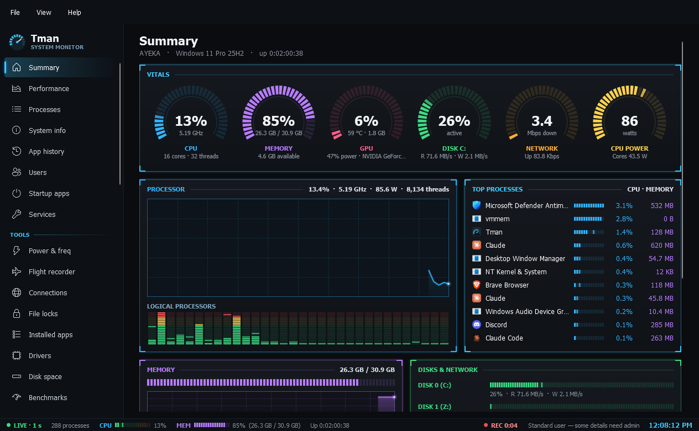

Tman grows from a task manager into a Windows admin suite. This is a **pre-release**: everything renders and the read-only pages are well tested, but many actions that change Windows have only been tested on throwaway keys and stand-ins so far. [Testing status](https://github.com/JawshTheDark/Tman/blob/main/docs/wiki/Testing-Status.md) has the full list.

## Install

1. Install the [.NET 10 Desktop Runtime](https://dotnet.microsoft.com/download/dotnet/10.0) for x64.
2. Download `Tman.exe` below and run it. It doesn't need installing.

Tman runs as a standard user. Pages that need more offer **Restart as administrator**. Windows SmartScreen may warn you the first time, because this build isn't code-signed.

## What's new

| | |
| --- | --- |
| **Diagnose** | Crash history, event log, disk health, devices, battery, latency capture and memory map. Processes gains a network column, a "Not responding" status and wait chains. |
| **Tweaks** | 153 settings with presets, undo, export and import. |
| **Context menus** | Hide, restore and add right-click entries. |
| **Get apps** | Bulk install, update and removal through winget. |
| **Docker** | Containers, images, volumes, networks and Compose stacks, plus Quick deploy with about 840 apps from nine template lists, with icons. |
| **ISO builder** | Turns an official Windows 11 ISO into a smaller one. |
| **Hyper-V** | Virtual machines, checkpoints and New VM. |
| **More admin pages** | Windows features, control panels, scheduled tasks, Windows Update modes, accounts, environment variables and shared folders. |
| **Network** | Firewall, network tools, hosts file and a security board. |
| **Repair** | System repair, restore points and disk cleanup. |
| **Tray** | One icon of coloured bars with a live flyout on hover. Separate icons are still available. Only one copy of Tman runs at a time. |

## Known limits

- **Docker** has only been tested against a stand-in for the `docker` command, never real Docker.
- **ISO builder** had not done a real build when this was released. Don't use its output yet.
- **Hyper-V** hasn't been tested against real Hyper-V.
- **Tweaks and other write actions** were tested on throwaway registry keys and copies. Create a restore point before using them on a PC you care about.
- **Restart as administrator** hasn't been retested with a real UAC prompt since the one-copy change.
- **The tray flyout** was tested with simulated hover signals, not yet from the real taskbar.
- **Battery** has only seen sample data.
- **Non-English Windows** is untested.
