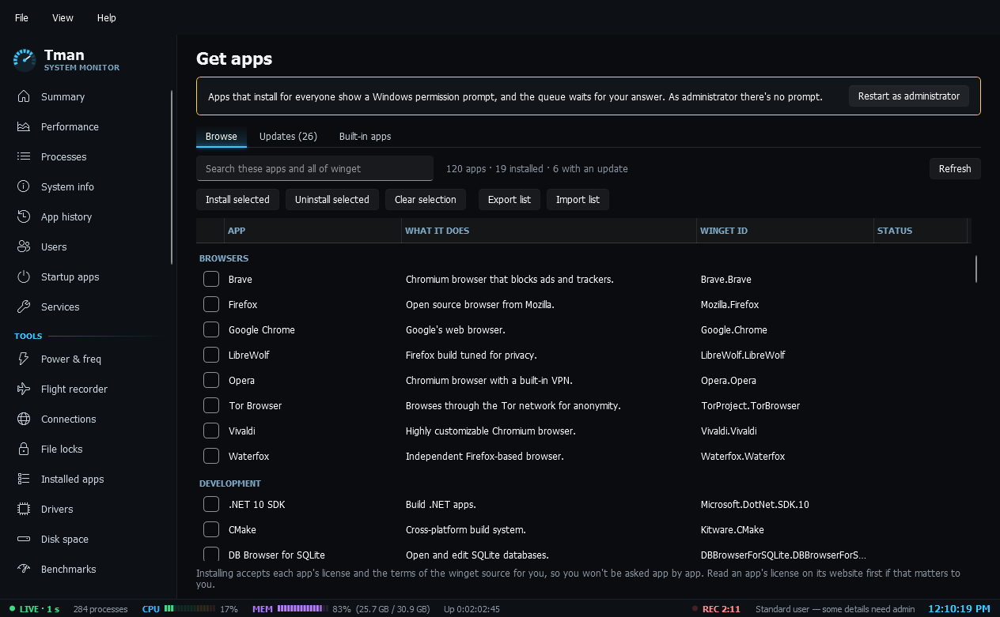

# Other admin tools

- **Get apps**: a bulk installer built on winget. Browse has 120 popular free apps by category with install status, plus a live search of the whole winget catalog; tick apps to install or uninstall them, or export the list as a JSON file that works on another PC. Updates lists available updates with Update selected and Update all. Built-in apps removes bundled Store apps for your account, keeps anything Windows depends on protected, and has a Select common extras button. Everything runs through a one-at-a-time queue with a live log and per-app results, and the queue can be cancelled between apps. Installing accepts each app's license and the winget source's terms for you.
- **Windows features**: the useful optional features with a plain description, every other feature with search, and OpenSSH client and server with service and firewall state. Turning something on or off runs through DISM with live output and says when a restart is needed.
- **Control panels**: a launcher for classic Windows tools that are hard to find now, such as Programs and Features, Network Connections, User Accounts (automatic sign-in), Disk Management, Registry Editor, Group Policy, Reliability Monitor and the Windows Tools folder, grouped by purpose with a line on what each is for.
- **Scheduled tasks**: every task in every folder with its state, last run, last result in plain words, next run, author and action. Filter out Microsoft's tasks, show failed runs, and search. Run, end, enable or disable a task, and select one to see its triggers and full action.
- **Windows Update**: update history with failures explained in plain words, a background search for pending updates, the last check and install times, and an update mode: Default, Security-focused (feature updates wait 365 days, quality updates 4 days, drivers left out), Pause for up to 5 weeks, or Off (disables the update services and sets the no-automatic-updates policy; a restart is needed, and Windows' repair service can switch the services back on, so the policy is the part that holds). It reads live values and says when someone else's policy set them. Switching needs admin.
- **Registry cleaner**: scans a few well-defined places only — uninstall entries, App Paths, Run keys, Applications file handlers and shared-DLL counters — for entries whose target program file is gone. It shows each with its key, what it points at and why it's flagged, and judges a target missing only when its drive is a ready, fixed NTFS/ReFS volume; network and unavailable drives (including FUSE mounts that vanish when elevated) are reported unknown and never flagged. Nothing is ticked by default, nothing is removed until you confirm, and Tman writes a `.reg` backup first that one click restores. Entries under HKLM need admin.
- **Accounts**: local users and groups with enabled state, administrator status, last sign-in, password required and group memberships. Enable or disable an account and change who is an administrator, with a refusal if that would leave no enabled administrator. Passwords are never shown or set: use the buttons for User Accounts and Local Users and Groups. Changes need admin.
- **Environment**: user and system variables as stored, so %NAME% references and REG_EXPAND_SZ survive. Add, edit and delete, plus a PATH editor that flags missing folders and duplicates and lets you reorder and remove entries. Each change saves a dated backup to `%APPDATA%\Tman\backups\` first and tells running apps. System variables need admin.
- **Shared folders**: shares with admin shares marked, connected sessions, open files, and whether file sharing is on for the network in use. Stop sharing or close a session. Sessions, open files and both actions need admin.

The larger tools have their own pages: [Tweaks](Tweaks.md), [Context menus](Context-Menus.md), [Docker](Docker.md), [ISO builder](ISO-Builder.md) and [Hyper-V](Hyper-V.md).
