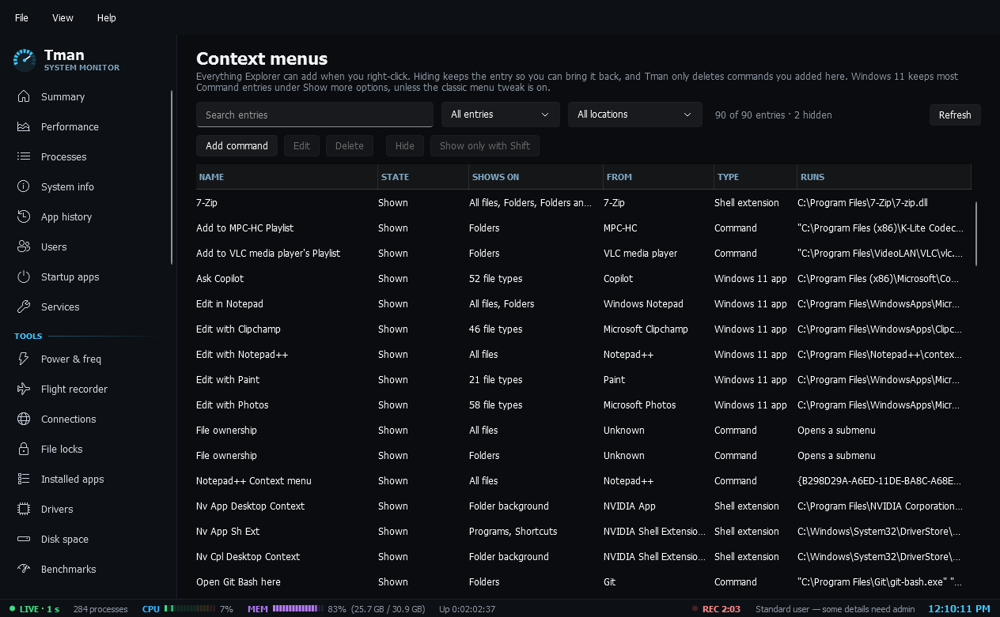

# Context menus

**Context menus**: every entry Explorer can add to its right-click menus, including shell extensions and Windows 11 app entries, with where it shows, who added it and what it runs. Hide an entry and bring it back, keep a command for Shift + right-click, or add your own commands for files, folders, the desktop and drives. Hiding needs no admin and never deletes anything, Tman only deletes commands added here, and anything Windows needs to open items stays locked.
