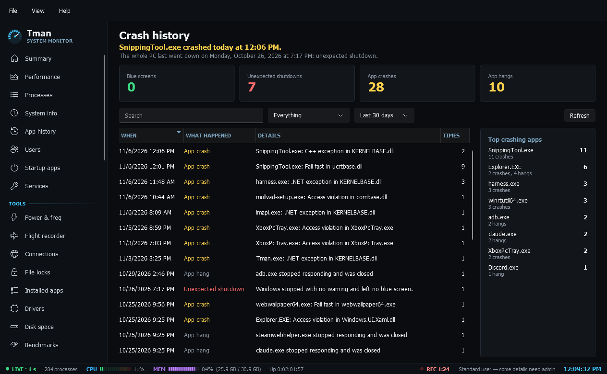

# Diagnose

Pages for finding out what went wrong.

- **Crash history**: one timeline of blue screens, unexpected shutdowns, app crashes and app hangs from the event logs, with counters, top crashing apps and filters by kind and time range. Stop codes and exception codes are explained in plain words, repeats of one app are merged, and blue screens link to their minidump.
- **Event log**: a fast viewer for any readable log, filtered by level, time range and search text, with an option to group by source and the full message in a details pane. Reads are limited by time and capped at 10,000 events, and the page says when the cap is reached. Reading the Security log needs administrator rights.
- **Disk health**: a card per physical drive with a verdict (Healthy, Check soon, Failing or Unknown) and the reason, plus temperature, life remaining, power-on time, data written and error counts. NVMe health is read without admin; admin adds read and write error totals and SMART data for SATA drives. A drive that doesn't report enough stays Unknown, never Healthy by default.
- **Devices**: Device Manager's list with problem devices first, each problem in plain words with what to try. Filter by class or "Problems only", search, enable or disable a device, scan for hardware changes (those three need admin), and open Device Manager or search online.
- **Battery**: charge, state, charge rate, voltage and time remaining, updated live, plus design against full charge capacity, wear and a plain verdict, and the cycle count where the battery reports one. Desktops show "This PC has no battery".
- **Latency**: finds what's causing stutter and audio crackle. Runs a fixed kernel trace of every DPC and ISR, then shows per driver how many there were and their total, average and longest time in microseconds, with a plain verdict for audio and gaming and the likely culprit. Needs administrator rights.
- **Memory map**: what RAM is really used for. A bar of in use, modified, standby, free, zero and hardware reserved with a plain line for each, standby by priority, commit, paged and non-paged pool, file cache and the top pool tags. It can also empty the standby list (admin), though Windows refills it and it rarely helps.
