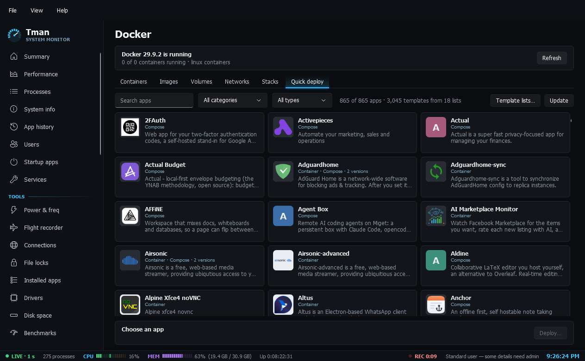
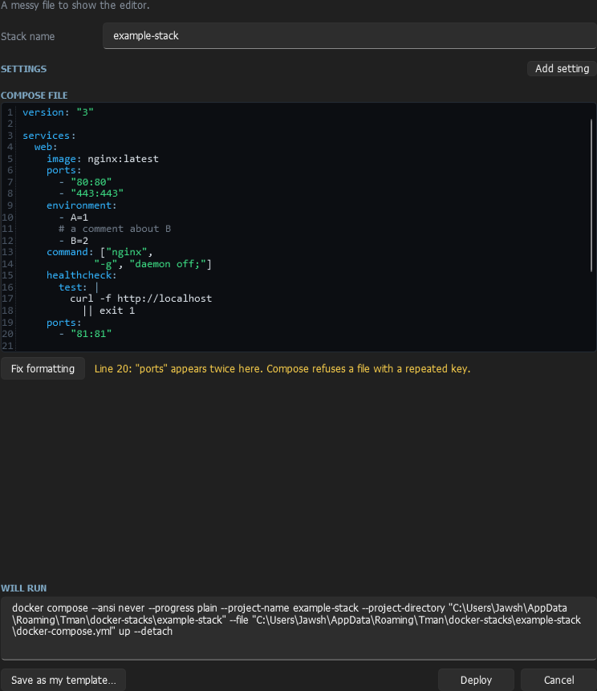

# Docker

The Docker page lives under **Admin**. It controls Docker Desktop on this PC and deploys apps from public template lists.

## Getting Docker

If Docker isn't installed, the page offers **Install Docker Desktop**, which uses winget. Linux containers run in a small virtual machine, so Docker Desktop needs WSL, and turning that on needs a restart. Docker Desktop is free for personal use and small businesses, and larger companies need a paid plan.

You can browse Quick deploy before installing anything.

## Managing what's running

| Tab | What you can do |
|---|---|
| Containers | See live CPU and memory, then start, stop, restart, remove, view logs, open a shell, inspect, or open in a browser |
| Images | Pull, remove, and remove unused images |
| Volumes | Remove a volume, or remove unused ones. This permanently deletes the data in them |
| Networks | List networks and remove your own |
| Stacks | Start, stop, restart and remove Compose stacks, view logs, and open their folder |

## Quick deploy

Quick deploy merges nine template lists into one gallery of about 840 apps, and you can add more lists of your own.

1. Search, or filter by category or type.
2. Click an app. If it has several versions, choose one beside the **Deploy** button.
3. Click **Deploy**, or double-click the card, and review the form.

Nothing starts until you confirm. The form shows the exact command that will run. For Compose stacks you can read and edit the whole file first.

### Safe defaults

- **Ports stay on this PC.** They answer only at `localhost` unless you tick **Let other devices on my network connect**. Many templates ship with a default password or none.
- **Storage is yours to choose.** Template paths like `/portainer/...` come from the author's server, so single containers use Docker volumes instead. You can enter a Windows folder or use **Browse**.
- **Warnings are shown first.** The form flags privileged containers, access to the Docker socket and host networking. You can turn privileged mode off.

Anyone can publish a template list. A template can run any software, so only deploy apps you trust.

### Template lists

Use **Template lists…** to add or remove lists, one https address per line. Earlier lists come first when two describe the same app. Use **Update** to download them again. Otherwise they refresh once a week. If a list goes dead, its saved copy keeps working.

Apps are merged when they share a name or an image. Exact copies are dropped, and different builds stay as versions of one card.

### Icons

Icons are downloaded as cards scroll into view, then saved on your PC. They come from whichever site the list names, so that site can see your IP address. If an icon is missing or is an SVG, which Tman can't draw, Tman tries the [dashboard-icons](https://github.com/homarr-labs/dashboard-icons) set, then falls back to a lettered tile.

## The Compose editor

Compose files and settings (`.env`) files open in an editor with line numbers and colours for keys, values, strings, `${VARIABLES}` and comments. The Tab key types two spaces, because YAML can't be indented with tabs.

**Fix formatting** lays the file out the standard way: two spaces a level, list items indented under their key, one blank line between services. It changes spacing only, never a value, and Docker reads the file the same before and after. Afterwards it points out anything it can't settle, such as a key that appears twice or a bracket that never closes, with the line number. Ctrl+Z puts the old layout back.

## What can't be deployed

Templates that need Docker Swarm are listed but can't be deployed from Tman. If a Compose file has been removed by its author, Tman says so, and you can try another version if the app has one.
