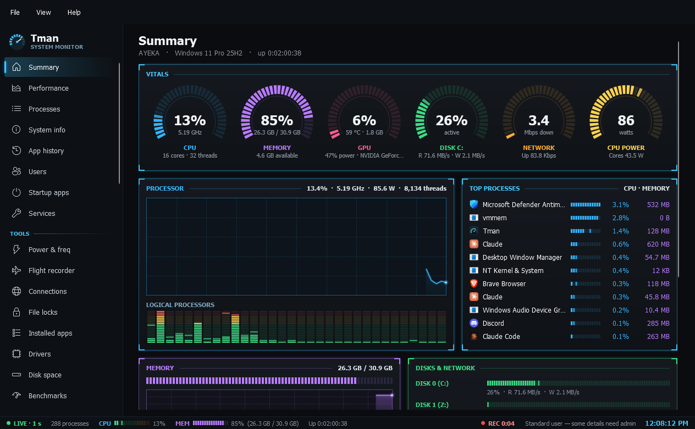

# Tman Wiki

**Tman** is a free task manager and admin toolkit for Windows 11. It started as a Task Manager replacement and is growing into one app for most Windows utilities: monitoring, diagnosis, tweaks, Docker, Hyper-V, repair and more. One exe, no installer, and it runs as a standard user.

**Current version:** [0.2.0](https://github.com/JawshTheDark/Tman/releases/latest), a pre-release. Read [Testing status](Testing-Status.md) before using actions that change Windows.

## Start here

| I want to… | Read |
| --- | --- |
| Install Tman and get going | [Getting started](Getting-Started.md) |
| Know what's been tested before I trust a button | [Testing status](Testing-Status.md) |
| Find what's slowing the PC down or using memory | [Monitoring](Monitoring.md), then [Diagnose](Diagnose.md) |
| Find out why it crashed, stutters or a drive worries me | [Diagnose](Diagnose.md) |
| Turn off ads, AI features and tracking | [Tweaks](Tweaks.md) |
| Tidy the right-click menu | [Context menus](Context-Menus.md) |
| Run self-hosted apps in Docker | [Docker](Docker.md) |
| Make a smaller Windows 11 install disc | [ISO builder](ISO-Builder.md) |
| Run a virtual machine | [Hyper-V](Hyper-V.md) |
| Install many apps at once, or change Windows features | [Other admin tools](Admin-Tools.md) |
| Fix the network, DNS or the hosts file | [Network](Network.md) |
| Repair Windows or make a restore point | [Repair](Repair.md) |
| Keep an eye on things from the taskbar | [Tray icon](Tray-Icon.md) |
| Build it myself | [Building Tman](Building.md) |

## Guides

- [Getting started](Getting-Started.md): install, administrator rights, closing to the tray, where your data lives
- [Monitoring](Monitoring.md): Summary, Performance, Processes, App history, Startup apps, Services, Power & freq, Flight recorder and the other everyday pages
- [Diagnose](Diagnose.md): crash history, event log, disk health, devices, battery, latency, memory map and the leak monitor
- [Tweaks](Tweaks.md): 153 Windows settings with presets, undo, export and import, and what's left out on purpose
- [Context menus](Context-Menus.md): hide, restore and add right-click entries
- [Docker](Docker.md): containers, stacks, editing and updating, the network map, Quick deploy, template lists and the Compose editor
- [ISO builder](ISO-Builder.md): make a smaller Windows 11 ISO and write it to USB
- [Hyper-V](Hyper-V.md): virtual machines, checkpoints, New VM and the built-in console
- [Other admin tools](Admin-Tools.md): Get apps, Windows features, control panels, scheduled tasks, Windows Update, accounts, environment variables and shared folders
- [Network](Network.md): firewall, network tools, hosts file and the security board
- [Repair](Repair.md): system repair and restore points
- [Tray icon](Tray-Icon.md): the live icon, the flyout and separate icons

## Project

- [Testing status](Testing-Status.md): what has been proven and what hasn't
- [Building Tman](Building.md): build, publish, how it gets its data, dev flags
- [Releases](https://github.com/JawshTheDark/Tman/releases) and [issues](https://github.com/JawshTheDark/Tman/issues) on GitHub

These pages live in [`docs/wiki`](https://github.com/JawshTheDark/Tman/tree/main/docs/wiki) in the repository and are copied to the Wiki tab on every change, so edits belong there.
