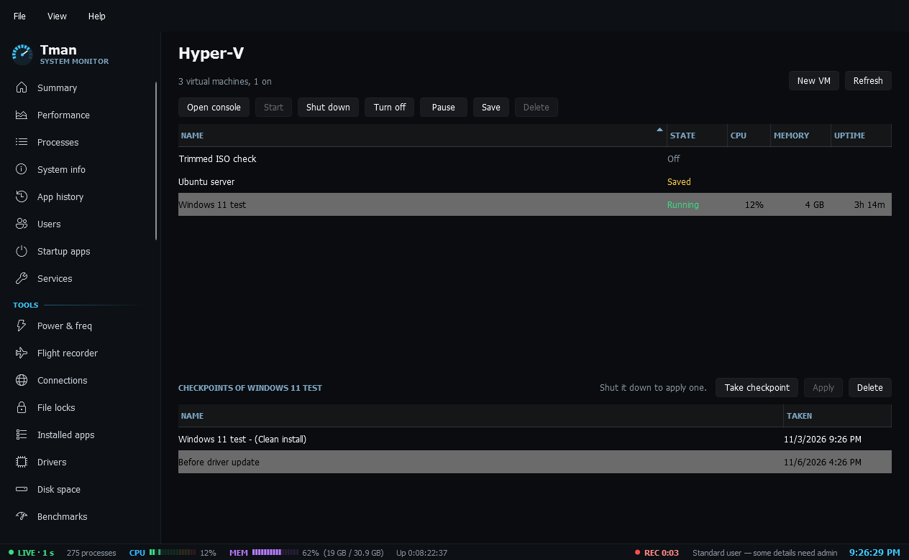

# Hyper-V

**Hyper-V**: virtual machines on this PC with state, CPU, memory and uptime. Start, shut down, turn off, pause, resume and save a VM, open its console, and take, apply and delete checkpoints. New VM makes one from an ISO with a name, generation, memory, processors, disk size and network, plus Secure Boot and a virtual TPM for Generation 2. The defaults suit Windows 11, and if a step fails, what was made so far is removed. Turning off, applying a checkpoint and deleting each say what's lost first, and deleting a VM asks separately about its disk files, leaving out any that another VM still uses. If Hyper-V isn't turned on, the page says so and points to Windows features. It never turns Hyper-V on itself. Needs admin or membership of the Hyper-V Administrators group.
