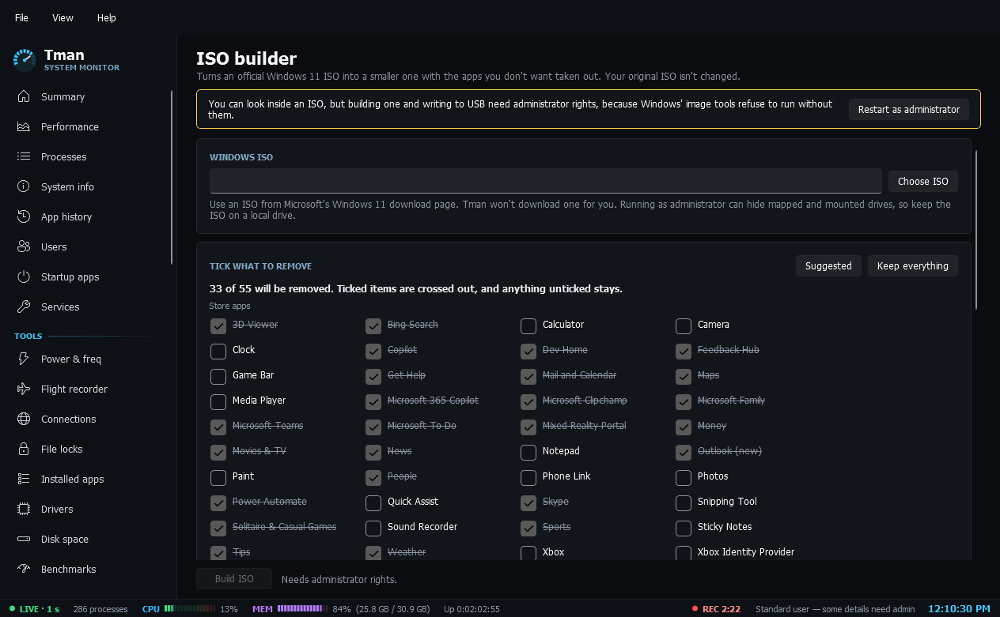

# ISO builder

**ISO builder**: turns an official Windows 11 ISO into a smaller one. Choose an ISO you already have (Tman doesn't download one) and an edition, tick which Store apps and extras to remove, and optionally add an answer file that skips the Microsoft account step by creating a local administrator account with no password. Setup still asks which disk to install to. It checks for free space first (about 35 GB while it builds) and takes 20 minutes to an hour or more, with live output, and your original ISO isn't changed. The ISO is set up to boot on BIOS and UEFI, and is made with `oscdimg` if the Windows ADK is installed, or with Windows' built-in image writer if it isn't, so there's nothing to install. Stopping a build, closing Tman or ending it in Task Manager discards the mounted image and deletes the temporary files. A second Tman process watches each build to make sure of that, and if the power goes too, Tman finishes the job the next time it starts as administrator. A finished ISO can be written to a USB drive as FAT32, the format PCs can boot from. The confirmation names the drive and its size and warns that it erases the drive, and Tman refuses Windows' own drive and anything that isn't USB. Looking inside an ISO works for anyone; building and writing to USB need admin. Keep the ISO on a local drive, because running as administrator can hide mapped and mounted drives. This page is new and hasn't been run end to end yet: a full build, stopping one, writing a USB drive and booting the result are all still untested.

## How far it has been tested

A full build from a Windows 11 build 26300 ISO, a USB write, and an install of the result in a Hyper-V virtual machine under Secure Boot, which reached the desktop on a local account with no network. Not yet: booting a real PC from the written USB drive, the answer file on a PC with internet, and ending a build partway other than during the mount. See [Testing status](Testing-Status.md).

## Which drive

Running as administrator can hide mapped and mounted drives, so keep the ISO on a local drive. The USB card refuses Windows' own drive and anything that isn't a USB drive, and names the drive and its size before it erases anything.
