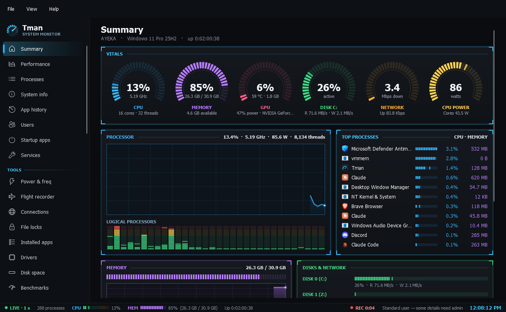

# Monitoring

The everyday pages at the top of the sidebar.

- **Summary**: an instrument-panel dashboard. LED arc gauges for CPU, memory, GPU (with temperature), disk, network and CPU power; the processor trace with an LED bar per logical processor; the busiest processes; memory, disk and network meters.
- **Performance**: 60-second graphs per device. Includes a per-core CPU view, GPU engine graphs (3D, copy, video), GPU temperature, power, fan and clocks (NVIDIA through NVML, other GPUs through the same driver data Task Manager uses), disk transfer rates and network throughput.
- **Processes**: every process, with CPU, memory, I/O and GPU columns shaded by load, and a Signer column (verified Authenticode signer, including Windows catalog signatures; unsigned programs show in amber). Supports search, end task or end tree, suspend/resume, set priority and CPU affinity, create a full memory dump, open file location and properties. Double-click (or Enter) opens a Details window with threads (state, CPU, name, start address), loaded modules, environment variables and open files. Its Wait chain tab, also reachable from "Analyze wait chain" on the right-click menu, shows what each blocked thread is waiting for, follows the chain into other processes by name, and calls out deadlocks in plain words. Apps that have stopped responding show in red in Status. A Network column shows each process's combined send and receive rate, from a trace that runs only as administrator and only while the column is visible. Right-click a column header to choose which columns show.
- **System info**: OS, board, BIOS, CPU, RAM modules, GPUs, disks and network adapters, with a "Copy all" button.
- **App history**: CPU time, GPU time, disk I/O, peak memory and launch count per app, kept across sessions. Windows keeps its own history in a database only Task Manager can read, so Tman records its own while it runs.
- **Users**: signed-in sessions with their process count, CPU and memory. You can disconnect a session or sign it off.
- **Startup apps**: registry Run keys and Startup folders, enabled or disabled the same way Windows does it (the StartupApproved keys); scheduled tasks that run at sign-in or startup (Windows' own tasks hidden unless you ask); plus RunOnce, Group Policy Run keys, Winlogon shell overrides and AppInit DLLs, which are shown for awareness and can be opened in Registry Editor.
- **Services**: start, stop and restart services, change the startup type, and filter by state.
- **Power & freq**: measured clock for each logical processor, throttling, core parking, CPU package and per-core power (from RAPL energy counters, where the CPU exposes them), and the power plan and Windows 11 power mode, which you can switch from here. It also shows the last wake source, recent sleep and wake history, wake timers, devices allowed to wake the PC, and what's keeping it awake. Wake timers and what's keeping it awake need administrator rights.
- **Flight recorder**: the last hour of CPU, memory, GPU, disk, network and power in memory. Click the timeline to see the top processes at that moment. It also logs process starts and exits and sustained CPU or memory spikes, and exports to CSV.
- **Connections**: TCP/UDP connections by owning process, with optional reverse-DNS host names. Right-click to block a program's outgoing traffic with a Tman-named firewall rule (needs admin).
- **File locks**: find which processes have a file or folder open (or a DLL loaded), the usual cause of "file in use" errors, and end them. As a standard user only your own processes can be searched.
- **Installed apps**: the uninstall registry, with size, version and date, plus an Uninstall button.
- **Drivers**: signed PnP drivers with provider, version, date and signature, and an option to hide Microsoft drivers.
- **Disk space**: drive usage, plus a fast parallel folder-size analyzer you can drill into. The Cleanup tab sizes up temp files, the Recycle Bin, thumbnail cache, crash dumps, error reports, update and Delivery Optimization files and the DirectX shader cache, then cleans what you tick. It skips files in use and reports how much was freed and skipped.
- **Benchmarks**: about 30 seconds of CPU (single and multi-thread), memory (bandwidth and latency) and drive tests (sequential, random 4K at queue depths 32 and 1, unbuffered). Results are saved so you can compare runs. CPU scores are relative, with 1,000 about one Ryzen 9 7950X core. The drive test writes at most about 5 GB to a temp file that deletes itself.
