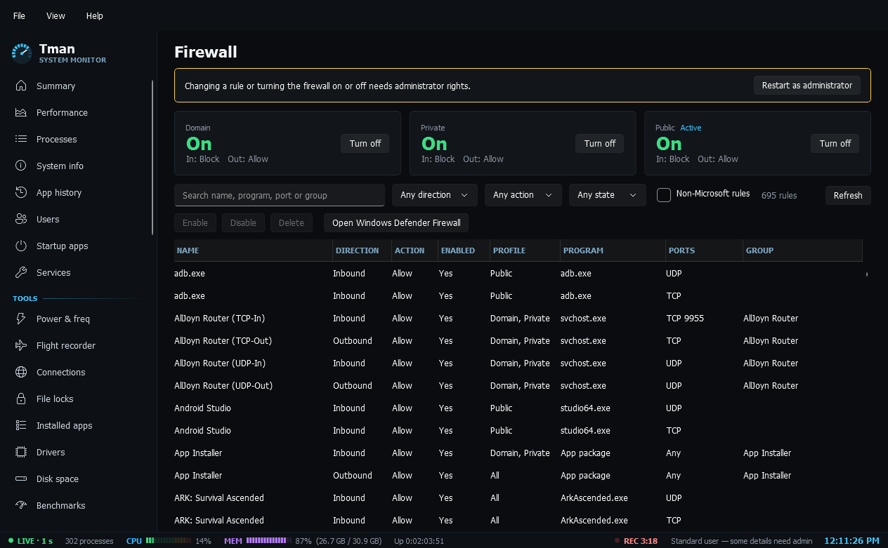

# Network

- **Firewall**: Domain, Private and Public status with default actions, plus every rule with filters for direction, action, state and non-Microsoft rules. Enable, disable or delete rules and turn a profile on or off (needs admin).
- **Network tools**: live ping and traceroute, DNS lookup with reverse names, adapter details, DNS provider switching (Automatic, Cloudflare, Google, Quad9 or custom), flush DNS, restart adapter, and saved Wi-Fi network names. Passwords are never read.
- **Hosts file**: entries as rows plus raw text, with add, edit, remove, enable and disable. Comments, order, encoding and line endings are kept. Each save makes a dated backup you can restore and flushes the DNS cache, and entries that redirect well-known sites are flagged. Saving needs admin.
- **Security**: a read-only board for antivirus, firewall, Secure Boot, TPM, memory integrity, BitLocker, UAC, Smart App Control, SmartScreen and Remote Desktop, with what each state means. Anything Tman can't read shows as unknown, never good.
