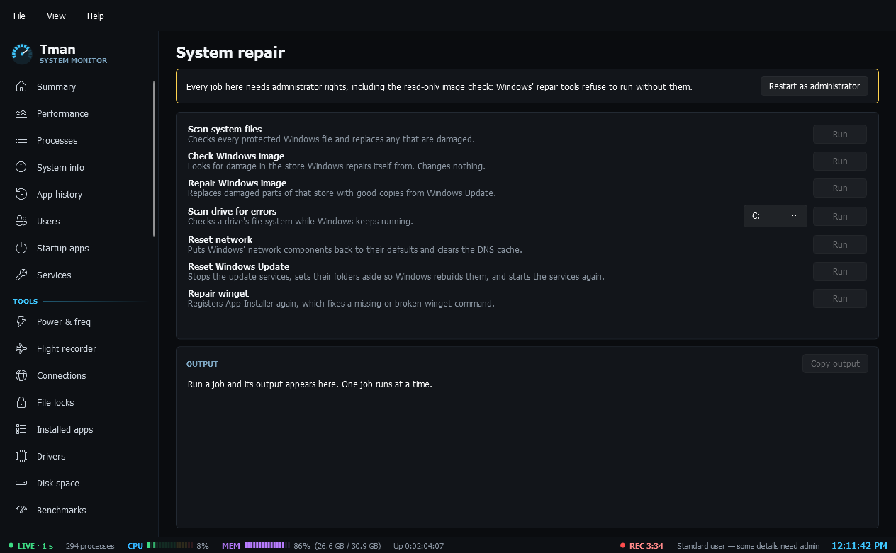

# Repair

- **System repair**: runs Windows' repair tools one at a time with live output and a plain-language result: scan system files, check or repair the Windows image, scan a drive for errors, reset the network, reset Windows Update (folders are renamed, never deleted) and repair winget. Needs administrator rights.
- **Restore points**: lists restore points with date, description and type, shows whether System Protection is on, creates a new one and explains when Windows skips it, and opens System Restore and System Protection. The list needs administrator rights.
