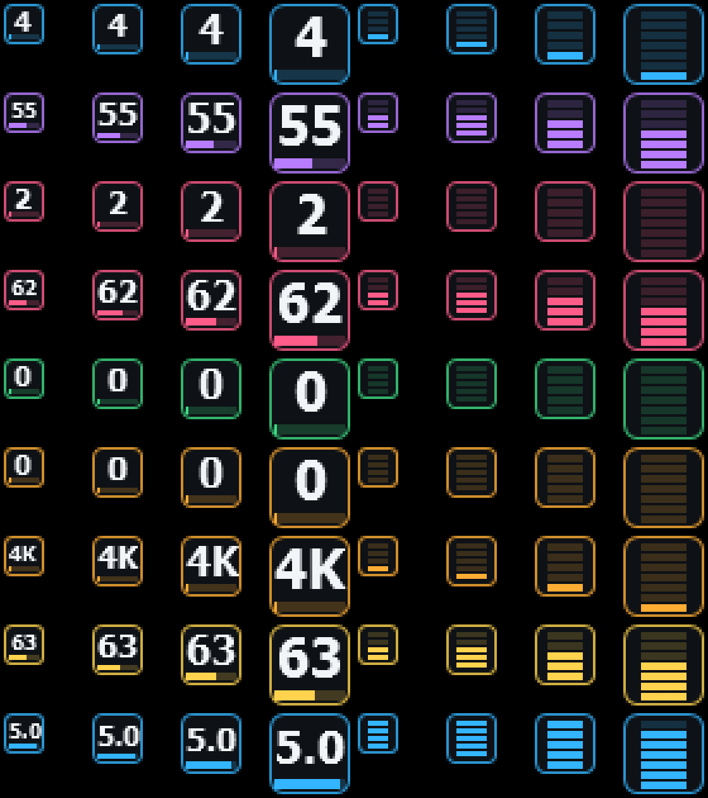

# Tray icon

Tman shows one live icon in the system tray, with a colored bar for each of up to three metrics. Hover over it for a flyout with every reading, or choose separate icons with a number or LED meter each. Set this up in **View > Tray icons…**:

- **Metrics**: CPU usage, memory, GPU usage, GPU temperature, disk activity, network download, network upload, CPU power and CPU clock. CPU, memory and GPU are on by default. The order in the list is the order in the tray.
- **Style**: a number with a level strip, or an LED meter, each in the metric's color.
- **Behavior**: hover for the flyout (a plain tooltip with separate icons), click to open Tman, right-click for a menu (Open, Tray icons…, Exit). By default, closing the window keeps Tman running in the tray. You can turn that off in the same dialog.
- **One copy**: starting Tman again brings the running copy forward instead of adding a second set of icons. If the new start is a newer build, Tman offers to replace the older copy.
- **Visibility**: Windows 11 puts new tray icons in the hidden-icons flyout (^). **Always show on the taskbar** pins them, or use Settings > Personalization > Taskbar > Other system tray icons.
