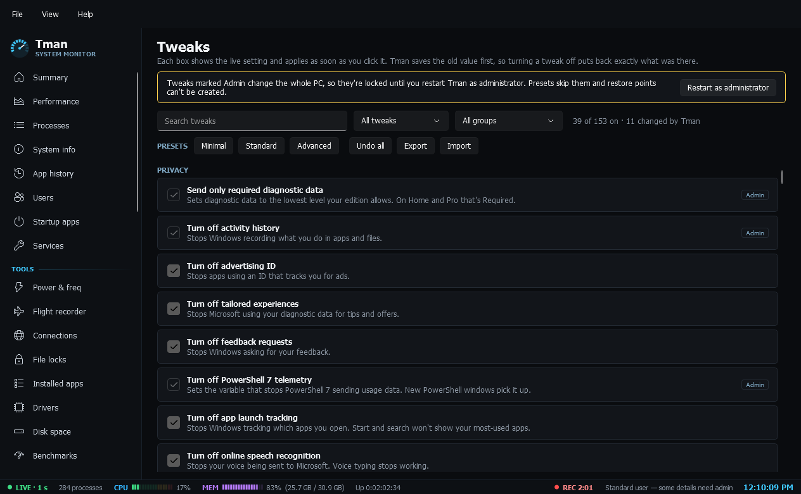

# Tweaks

**Tweaks**: 157 Windows settings for privacy, AI features, ads, Explorer, the right-click menu, the taskbar, notifications, performance, input, Windows Update, security and the system, each showing the live value and applying as soon as you click it. Search them or filter by group. Tman saves the old value first, so turning a tweak off puts back exactly what was there. Minimal, Standard and Advanced presets confirm the exact list and create a restore point first when running as administrator. The set can be exported and imported to apply on another PC. Tweaks that change the whole PC need admin.

## Using it safely

- Tick a box and the change applies straight away. Untick it to put back the exact value that was there.
- Tags on each row say what's needed: **Admin**, **Explorer restart**, **Sign out** or **Restart**.
- **Minimal** covers privacy and ads, and is low risk.
- **Standard** adds a tidier Explorer, Start and right-click menu, and a few safer defaults.
- **Advanced** adds changes that can get in the way, so read the list before you confirm.
- **Undo all** puts back everything Tman changed.

Create a restore point before applying a preset on a PC you care about. See [Testing status](Testing-Status.md).

## Reduce protection

A **Reduce protection** group turns off Windows' own defences: Microsoft Defender Antivirus, User Account Control, Core Isolation memory integrity, and the Spectre and Meltdown mitigations. (Turning Windows Update off lives on the [Windows Update](Admin-Tools.md) page, and the [registry cleaner](Admin-Tools.md) is its own page.)

These lower the PC's security, so they're left out of every preset and only change when you pick them by hand, and each needs admin. Each row shows the live value and says, factually, what the switch does and what it needs:

- **Microsoft Defender Antivirus** — Windows blocks the change while Tamper Protection is on, so Tman checks first and tells you to turn Tamper Protection off in Windows Security. Real-time protection returns at the next restart unless it's off. Meant for PCs that run another antivirus.
- **User Account Control (UAC)** — needs a restart, and some Store apps and built-in tools won't open while it's off.
- **Core Isolation memory integrity (HVCI)** — needs a restart; the row flags when the saved setting hasn't taken effect yet.
- **Spectre and Meltdown protections** — needs a restart; can speed up some older processors and leaves the PC open to those attacks.

As with every tweak, Tman saves the old value first, so turning one off puts back exactly what was there.
